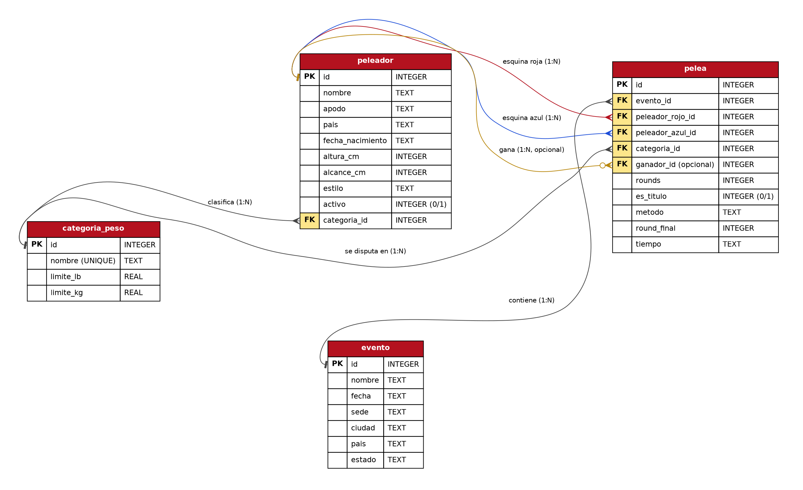
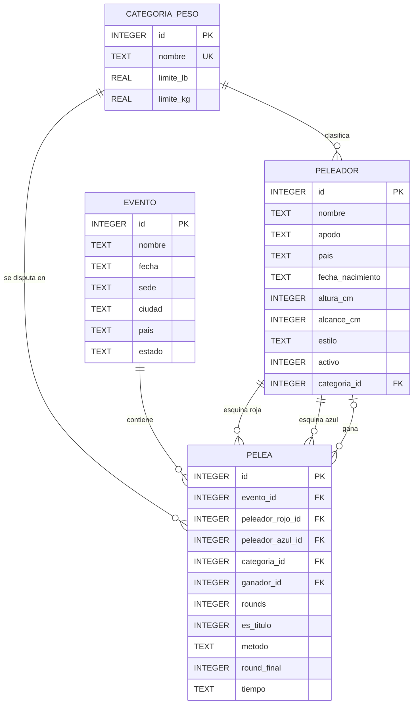

# Octagon Manager — Análisis y diseño

## 1. Análisis y planteamiento

**Nombre del proyecto:** Octagon Manager — Sistema de gestión de peleadores, eventos y peleas de MMA.

**Descripción del problema:** Las pequeñas promotoras y gimnasios de artes marciales mixtas (MMA)
suelen llevar el control de sus peleadores, carteleras y resultados en hojas de cálculo o cuadernos.
Esto provoca datos duplicados, resultados que no coinciden, imposibilidad de consultar el récord
de un atleta con rapidez y dificultad para armar la cartelera de un evento.

**Objetivo general:** Desarrollar una aplicación web que permita administrar de forma centralizada
los peleadores, las categorías de peso, los eventos y las peleas (con sus resultados), almacenando
la información en una base de datos SQLite y exponiéndola mediante una API REST con FastAPI.

**Principales funcionalidades**

| Módulo | Funcionalidad |
|---|---|
| Panel | Totales generales, próximo evento, top de victorias, peleas por método, peleadores por categoría |
| Peleadores | Crear, listar (con búsqueda y filtro por categoría), editar, eliminar, ver historial; récord V-D-E calculado automáticamente |
| Eventos | Crear, listar, editar, eliminar, ver cartelera |
| Peleas | Programar combates, registrar resultado (ganador, método, round, tiempo), editar, eliminar, filtrar por evento |
| Categorías de peso | Crear, listar, editar, eliminar |

**Usuarios del sistema**

- **Matchmaker / organizador del evento:** arma la cartelera y programa las peleas.
- **Administrador de la promotora:** registra peleadores, eventos y categorías.
- **Entrenadores y aficionados (consulta):** revisan el récord y el historial de los peleadores.

## 2. Diseño de la base de datos



Diagrama equivalente en Mermaid (se visualiza directamente en GitHub):



### 2.1 Descripción de las tablas

| Tabla | Descripción | Llave primaria | Llaves foráneas |
|---|---|---|---|
| `categoria_peso` | Divisiones de peso (Mosca, Gallo, …, Pesado) con su límite en libras y kilogramos. | `id` | — |
| `peleador` | Atletas registrados: datos personales, físicos y estilo de pelea. | `id` | `categoria_id` → `categoria_peso.id` |
| `evento` | Carteleras de la promotora: nombre, fecha, sede, ciudad, país y estado. | `id` | — |
| `pelea` | Combate entre dos peleadores dentro de un evento, con su resultado cuando ya se disputó. | `id` | `evento_id` → `evento.id`; `peleador_rojo_id`, `peleador_azul_id`, `ganador_id` → `peleador.id`; `categoria_id` → `categoria_peso.id` |

### 2.2 Relaciones

| Relación | Cardinalidad | Comportamiento al eliminar |
|---|---|---|
| `categoria_peso` — `peleador` | 1 : N | `RESTRICT` (no se elimina una categoría con peleadores) |
| `categoria_peso` — `pelea` | 1 : N | `RESTRICT` |
| `evento` — `pelea` | 1 : N | `CASCADE` (al eliminar un evento se eliminan sus peleas) |
| `peleador` — `pelea` (esquina roja) | 1 : N | `RESTRICT` (no se elimina un peleador con peleas) |
| `peleador` — `pelea` (esquina azul) | 1 : N | `RESTRICT` |
| `peleador` — `pelea` (ganador) | 1 : N (opcional) | `RESTRICT` |

> Un mismo peleador se relaciona con `pelea` por tres llaves foráneas distintas (rojo, azul y ganador).
> El récord (victorias, derrotas, empates) **no se guarda**: se calcula con consultas sobre `pelea`,
> evitando datos duplicados que puedan quedar inconsistentes.

### 2.3 Reglas de integridad (restricciones)

- `categoria_peso.nombre` es `UNIQUE`; los límites de peso deben ser > 0.
- `peleador.altura_cm` y `alcance_cm` tienen rangos válidos; `activo` solo admite 0 o 1.
- `evento.estado` solo admite `Programado`, `Finalizado` o `Cancelado`.
- `pelea`: rounds = 3 o 5; el peleador rojo y el azul deben ser distintos; el ganador debe ser uno de los dos;
  el método pertenece a una lista definida.
- Además, Pydantic valida en la API: edad mínima de 18 años, formato de tiempo `m:ss`, coherencia entre
  ganador y método, y que el round final no supere los rounds pactados.

## 3. Arquitectura

```
Navegador (HTML + CSS + JavaScript)
        │  fetch() — JSON
        ▼
API REST — FastAPI (Python)         app/routers/*.py
        │  sqlite3 (consultas parametrizadas)
        ▼
Base de datos SQLite                database/mma.db
```

## 4. Endpoints de la API

| Método | Ruta | Descripción |
|---|---|---|
| GET | `/api/categorias` · `/api/categorias/{id}` | Listar / consultar |
| POST | `/api/categorias` | Crear |
| PUT | `/api/categorias/{id}` | Actualizar |
| DELETE | `/api/categorias/{id}` | Eliminar |
| GET | `/api/peleadores?buscar=&categoria_id=` · `/api/peleadores/{id}` · `/api/peleadores/{id}/peleas` | Listar con filtros / consultar / historial |
| POST · PUT · DELETE | `/api/peleadores` · `/api/peleadores/{id}` | Crear / actualizar / eliminar |
| GET | `/api/eventos` · `/api/eventos/{id}` · `/api/eventos/{id}/peleas` | Listar / consultar / cartelera |
| POST · PUT · DELETE | `/api/eventos` · `/api/eventos/{id}` | Crear / actualizar / eliminar |
| GET | `/api/peleas?evento_id=` · `/api/peleas/{id}` | Listar / consultar |
| POST · PUT · DELETE | `/api/peleas` · `/api/peleas/{id}` | Crear / actualizar / eliminar |
| GET | `/api/estadisticas` | Datos del panel |
| GET | `/api/health` | Verificación del servicio |

**Códigos de respuesta:** `200` OK · `201` creado · `204` eliminado · `404` no encontrado ·
`409` conflicto (duplicado, referencia inexistente o registro en uso) · `422` datos inválidos.
